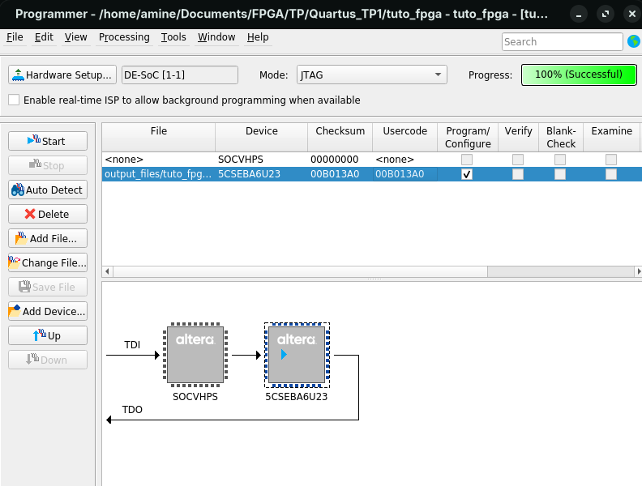
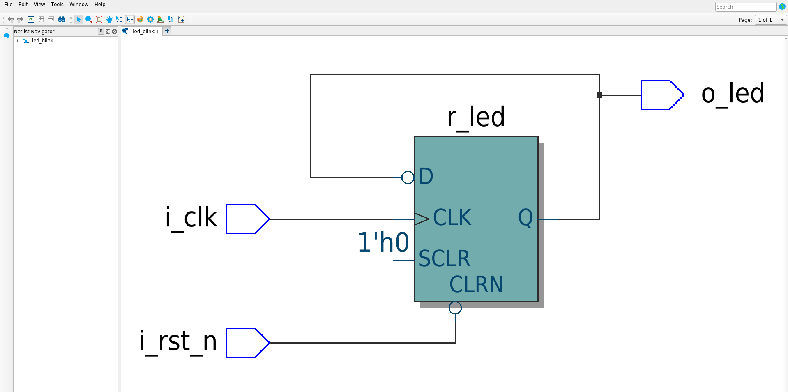
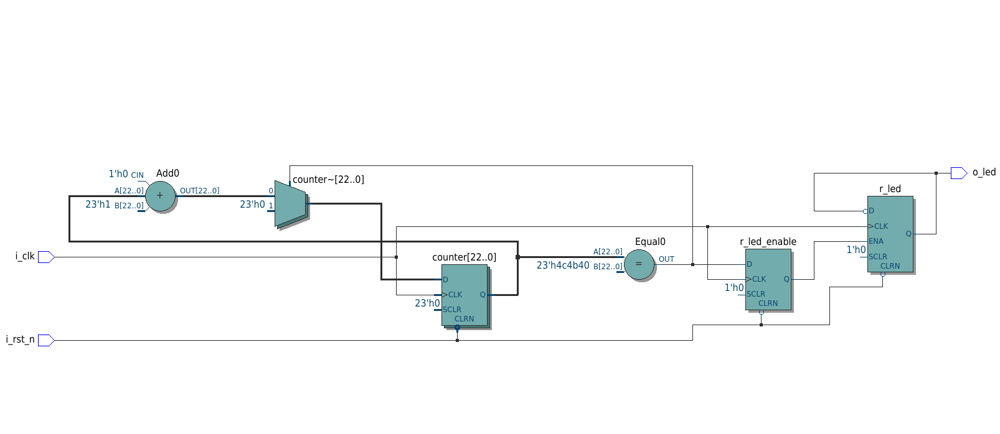
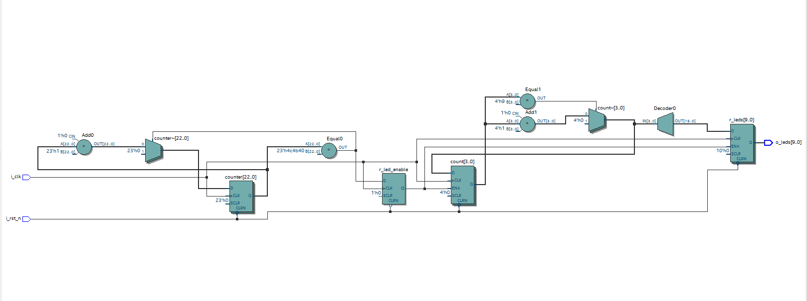
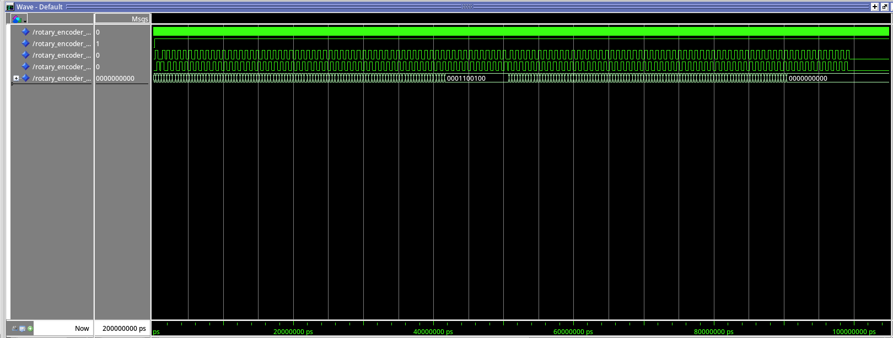
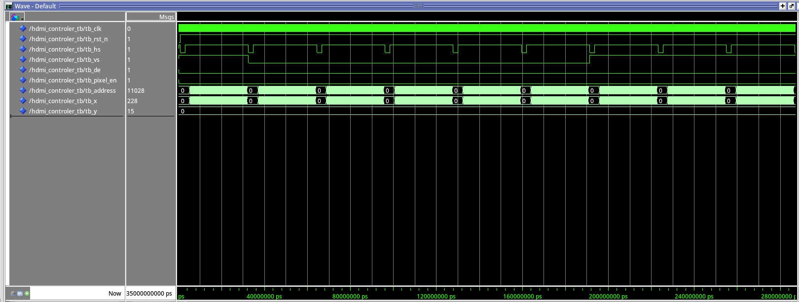
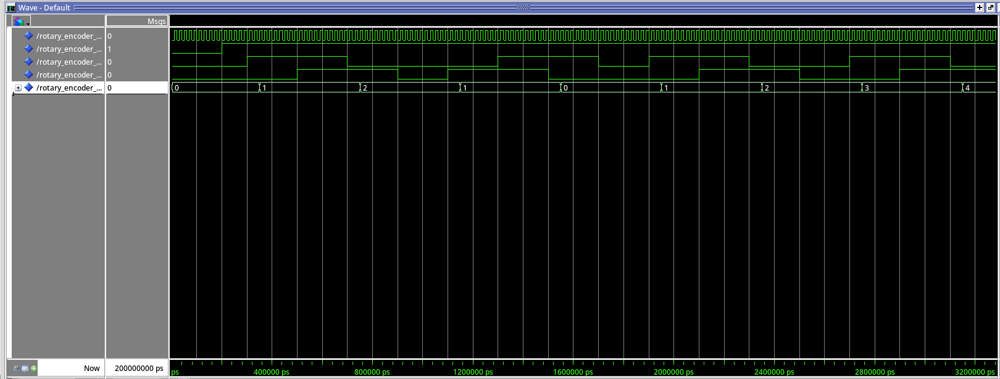
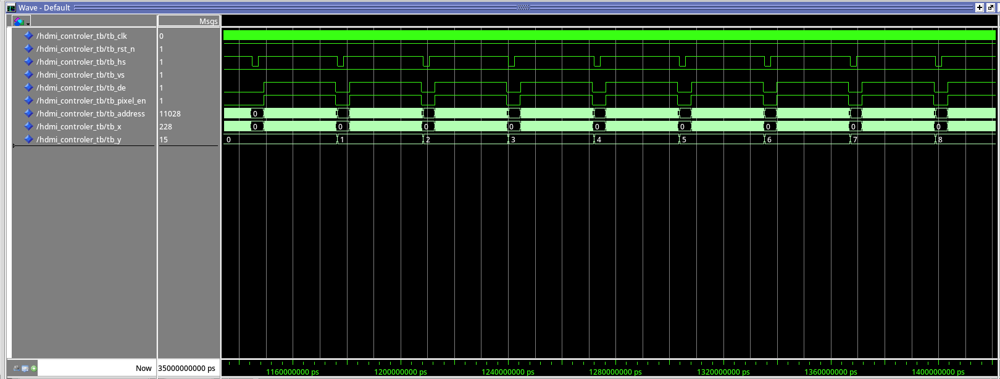
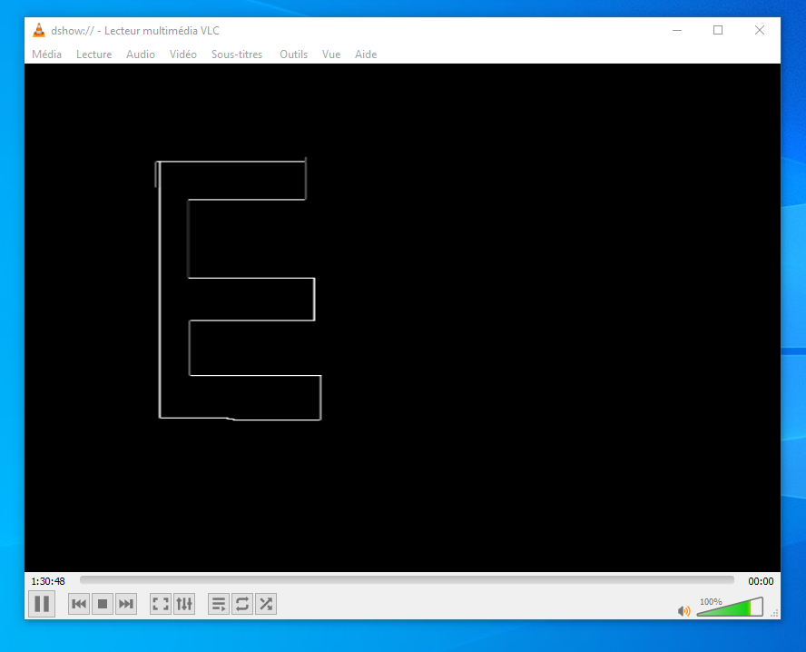

# TP1 FPGA — Tuto

**Auteurs :** MEGDER Mohamed Al Amine — HAJJI Abdelmoughit  
**Carte :** DE10-Nano (Cyclone V `5CSEBA6U23I7`) — **Logiciel :** Quartus Prime Lite 25.1

---

## 1. Tutoriel Quartus

### Code

```vhdl
library ieee;
use ieee.std_logic_1164.all;

entity tuto_fpga is
    port (
        pushl : in  std_logic;
        led0  : out std_logic
    );
end entity tuto_fpga;

architecture rtl of tuto_fpga is
begin
    led0 <= not pushl;
end architecture rtl;
```

### Broches

| Signal | Élément | Broche |
|---|---|---|
| `pushl` | Bouton encodeur gauche | `PIN_AH27` |
| `led0` | LED0 | `PIN_AG28` |



### Questions

**Q9 — Ça fonctionne ?** Oui, mais le comportement est inversé : la LED est allumée au repos et s'éteint à l'appui.

**Q10 — Correction :** le bouton est câblé avec une résistance de pull-up, il vaut `'1'` au repos et `'0'` à l'appui. On inverse donc l'entrée : `led0 <= not pushl;`


## 2. Faire clignoter une LED

**Q1 — Horloge :** `FPGA_CLK1_50` (50 MHz) est sur la broche **`PIN_V11`**.

### Version sans diviseur (Q3, Q4)

Schéma : une bascule D `r_led` dont la sortie est rebouclée sur l'entrée via un inverseur, avec un reset asynchrone.



Le RTL Viewer correspond au schéma : on retrouve la bascule et l'inverseur rebouclé.

**Q5 — Pourquoi ne pas tester ?** La LED change d'état à chaque front d'horloge (période 40 ns, soit 25 MHz) : c'est invisible à l'œil.

### Version avec diviseur (Q6, Q7, Q8)

```vhdl
library ieee;
use ieee.std_logic_1164.all;

entity led_blink is
    port (
        i_clk   : in  std_logic;
        i_rst_n : in  std_logic;
        o_led   : out std_logic
    );
end entity led_blink;

architecture rtl of led_blink is
    signal r_led        : std_logic := '0';
    signal r_led_enable : std_logic := '0';
begin
    process(i_clk, i_rst_n)
        variable counter : natural range 0 to 5000000 := 0;
    begin
        if (i_rst_n = '0') then
            counter := 0;
            r_led_enable <= '0';
        elsif (rising_edge(i_clk)) then
            if (counter = 5000000) then
                counter := 0;
                r_led_enable <= '1';
            else
                counter := counter + 1;
                r_led_enable <= '0';
            end if;
        end if;
    end process;

    process(i_clk, i_rst_n)
    begin
        if (i_rst_n = '0') then
            r_led <= '0';
        elsif (rising_edge(i_clk)) then
            if (r_led_enable = '1') then
                r_led <= not r_led;
            end if;
        end if;
    end process;

    o_led <= r_led;
end architecture rtl;
```

Le compteur génère une impulsion toutes les 5 000 001 × 20 ns ≈ **100 ms**. La LED change d'état à chaque impulsion : elle clignote à environ **5 Hz**. Le compteur nécessite 23 bits.



Le RTL Viewer montre le compteur (additionneur, comparateur, registre) et la bascule `r_led` commandée par `r_led_enable`.

### Reset (Q9, Q10, Q11)

| Signal | Élément | Broche |
|---|---|---|
| `i_clk` | FPGA_CLK1_50 | `PIN_V11` |
| `i_rst_n` | KEY0 | `PIN_AH17` |
| `o_led` | LED0 | `PIN_AG28` |

**Q11 — Que signifie `_n` ?** Le signal est **actif à l'état bas** : le reset agit quand `i_rst_n = '0'`. Le bouton KEY0 est relié à une pull-up : il vaut `'1'` au repos et `'0'` à l'appui. Sur la carte, la LED reste éteinte tant que KEY0 est enfoncé.


---

## 3. Chenillard

Un diviseur de fréquence génère une impulsion toutes les 100 ms. À chaque impulsion, un registre circulaire de 10 bits décale la LED allumée d'une position.

```vhdl
library ieee;
use ieee.std_logic_1164.all;

entity chenillard is
    port (
        i_clk   : in  std_logic;
        i_rst_n : in  std_logic;
        o_leds   : out std_logic_vector(9 downto 0)
    );
end entity chenillard;

architecture rtl of chenillard is
    signal r_leds       : std_logic_vector(9 downto 0) := "0000000001";
    signal r_led_enable : std_logic := '0';
begin

    process(i_clk, i_rst_n)
        variable counter : natural range 0 to 5000000 := 0;
    begin
        if (i_rst_n = '0') then
            counter := 0;
            r_led_enable <= '0';

        elsif rising_edge(i_clk) then
            if counter = 5000000 then
                counter := 0;
                r_led_enable <= '1';
            else
                counter := counter + 1;
                r_led_enable <= '0';
            end if;
        end if;
    end process;


    process(i_clk, i_rst_n)
        variable count : natural range 0 to 9 := 0;
    begin
        if (i_rst_n = '0') then
            r_leds <= "0000000000";
            count := 0;

        elsif rising_edge(i_clk) then
            if r_led_enable = '1' then

                if count = 9 then
                    count := 0;
                else
                    count := count + 1;
                end if;

                r_leds <= (others => '0');
                r_leds(count) <= '1';

            end if;
        end if;
    end process;

    o_leds <= r_leds;

end architecture rtl;

```

| LED | 0 | 1 | 2 | 3 | 4 | 5 | 6 | 7 | 8 | 9 |
|---|---|---|---|---|---|---|---|---|---|---|
| Broche | AG28 | AE25 | AG26 | AG25 | AG23 | AH21 | AF22 | AG20 | AG18 | AG15 |



https://github.com/user-attachments/assets/97b0a7cb-cddf-4355-968b-e5da5ef7f2d7

---

# TP3 FPGA — Projet « écran magique »

**Auteurs :** MEGDER Mohamed Al Amine — HAJJI Abdelmoughit  
**Carte :** DE10-Nano (Cyclone V `5CSEBA6U23I7`)  
**Logiciel :** Quartus Prime Lite 25.1, ModelSim 20.1

---

## 1. Objectif

Le projet consiste à réaliser un **télécran numérique** sur la carte DE10-Nano :

- deux encodeurs incrémentaux déplacent un stylet virtuel ;
- le stylet laisse une trace blanche sur un écran HDMI 720×480 ;
- la trace est mémorisée dans un framebuffer ;
- un bouton poussoir efface tout l'écran.

Le projet reprend les parties du TP :

1. gestion des encodeurs ;
2. contrôleur HDMI ;
3. déplacement d'un pixel ;
4. mémorisation dans une RAM dual-port ;
5. effacement de l'écran.

---

## 2. Architecture générale

```text
  Encodeur gauche ──► X (0..719) ──┐
                                  ├──► adresse = Y×720 + X ──► Port A (écriture)
  Encodeur droit  ──► Y (0..479) ──┘                              │
                                                                  ▼
                                                        Framebuffer 720×480×1 bit
                                                                  │
  Contrôleur HDMI ──► o_pixel_address ──► Port B (lecture) ───────┘
        │                                   │
        │                                   ▼
        └──► hs, vs, de ────────────► o_hdmi_tx_d (blanc/noir)

  Bouton encodeur gauche ──► machine d'états ──► effacement de la RAM
```

Le framebuffer est une mémoire **dual-port** :

- le port A est écrit à **50 MHz** par le côté encodeurs ;
- le port B est lu à **27 MHz** par le contrôleur HDMI.

Les deux ports sont indépendants, ce qui permet d'écrire un pixel pendant que l'écran en lit un autre.

---

## 3. Gestion des encodeurs

### 3.1 Principe de l'encodeur incrémental

Un encodeur incrémental délivre deux signaux **A** et **B** en quadrature. Lorsqu'on tourne l'encodeur, les états se succèdent dans l'ordre du code de Gray.

Sens horaire :

```text
00 → 10 → 11 → 01 → 00
```

Sens anti-horaire :

```text
00 → 01 → 11 → 10 → 00
```

Le TP donne les conditions suivantes :

- **Incrément** :
  1. front montant sur A avec B = 0 ;
  2. front descendant sur A avec B = 1.
- **Décrément** :
  1. front montant sur B avec A = 0 ;
  2. front descendant sur B avec A = 1.

### 3.2 Détection de front

Un front montant se détecte en comparant le signal courant à sa valeur au cycle précédent :

```vhdl
r_prev    <= i_signal;
s_rising  <= i_signal and not r_prev;
s_falling <= not i_signal and r_prev;
```

Comme A et B viennent d'un composant mécanique asynchrone, ils sont d'abord synchronisés par **deux bascules en cascade** pour éviter la métastabilité.

### 3.3 Version finale : échantillonnage lent et anti-rebond

La version finale du décodeur ajoute un **échantillonnage périodique**. Les signaux A et B sont synchronisés, puis le décodeur ne les examine que toutes les `G_TICK_CYCLES` horloges.

Avec `G_TICK_CYCLES = 25000` à 50 MHz, la période d'échantillonnage est de :

```text
25000 × 20 ns = 0,5 ms
```

Les rebonds mécaniques, plus courts que cette période, sont ainsi ignorés. Le décodage utilise une table de transitions Gray : seules les transitions valides sont prises en compte.

Le composant est paramétrable :

```vhdl
generic (
    G_WIDTH       : natural  := 10;
    G_MIN         : natural  := 0;
    G_MAX         : natural  := 1023;
    G_TICK_CYCLES : positive := 25000; -- 0,5 ms à 50 MHz
    G_DIV         : positive := 1      -- 1 = quart de pas, 4 = un pas par cran
);
```

- `G_WIDTH` : largeur du registre de position ;
- `G_MIN` / `G_MAX` : bornes de saturation ;
- `G_TICK_CYCLES` : période d'échantillonnage ;
- `G_DIV` : nombre de transitions nécessaires pour incrémenter la position.

### 3.4 Choix de `G_DIV`

| `G_DIV` | Effet |
|---:|---|
| `1` | Chaque transition compte : décodage au quart de pas |
| `2` | Un incrément tous les 2 fronts |
| `4` | Un incrément par cycle complet, donc **un pas par cran** |

Pour un stylet qui se déplace d'**un pixel par cran**, le réglage recommandé est :

```vhdl
G_DIV => 4
```

Dans le top fourni, les deux instanciations utilisent la valeur par défaut. Pour obtenir un pixel par cran, il suffit d'ajouter `G_DIV => 4` dans les deux `generic map`.

### 3.5 Code complet du décodeur

```vhdl
library ieee;
use ieee.std_logic_1164.all;
use ieee.numeric_std.all;

entity rotary_encoder is
    generic (
        G_WIDTH        : natural  := 10;
        G_MIN          : natural  := 0;
        G_MAX          : natural  := 1023;
        G_TICK_CYCLES  : positive := 25000;
        G_DIV          : positive := 1
    );
    port (
        i_clk   : in  std_logic;
        i_rst_n : in  std_logic;
        i_a     : in  std_logic;
        i_b     : in  std_logic;
        o_value : out std_logic_vector(G_WIDTH - 1 downto 0)
    );
end entity rotary_encoder;

architecture rtl of rotary_encoder is
    constant C_MIN : unsigned(G_WIDTH - 1 downto 0) := to_unsigned(G_MIN, G_WIDTH);
    constant C_MAX : unsigned(G_WIDTH - 1 downto 0) := to_unsigned(G_MAX, G_WIDTH);

    signal r_meta     : std_logic_vector(1 downto 0) := "00";
    signal r_sync     : std_logic_vector(1 downto 0) := "00";
    signal r_prev     : std_logic_vector(1 downto 0) := "00";

    signal r_tick_cnt : natural range 0 to G_TICK_CYCLES - 1 := 0;
    signal s_tick     : std_logic;

    signal r_init     : std_logic := '0';
    signal r_acc      : integer range -G_DIV to G_DIV := 0;
    signal r_value    : unsigned(G_WIDTH - 1 downto 0) := C_MIN;
begin
    s_tick <= '1' when (r_tick_cnt = G_TICK_CYCLES - 1) else '0';

    process (i_clk, i_rst_n)
        variable v_trans : std_logic_vector(3 downto 0);
        variable v_dir   : integer range -1 to 1;
        variable v_acc   : integer range -G_DIV to G_DIV;
    begin
        if (i_rst_n = '0') then
            r_meta     <= "00";
            r_sync     <= "00";
            r_prev     <= "00";
            r_tick_cnt <= 0;
            r_init     <= '0';
            r_acc      <= 0;
            r_value    <= C_MIN;

        elsif rising_edge(i_clk) then
            r_meta <= i_a & i_b;
            r_sync <= r_meta;

            if (s_tick = '1') then
                r_tick_cnt <= 0;
            else
                r_tick_cnt <= r_tick_cnt + 1;
            end if;

            if (s_tick = '1') then
                if (r_init = '0') then
                    r_prev <= r_sync;
                    r_init <= '1';
                else
                    v_trans := r_prev & r_sync;
                    r_prev  <= r_sync;
                    v_dir   := 0;

                    case v_trans is
                        when "0010" | "1011" | "1101" | "0100" => v_dir := 1;
                        when "0001" | "0111" | "1110" | "1000" => v_dir := -1;
                        when others => v_dir := 0;
                    end case;

                    v_acc := r_acc;
                    if (v_dir /= 0) then
                        v_acc := v_acc + v_dir;
                        if (v_acc >= G_DIV) then
                            v_acc := 0;
                            if (r_value < C_MAX) then
                                r_value <= r_value + 1;
                            end if;
                        elsif (v_acc <= -G_DIV) then
                            v_acc := 0;
                            if (r_value > C_MIN) then
                                r_value <= r_value - 1;
                            end if;
                        end if;
                    end if;
                    r_acc <= v_acc;
                end if;
            end if;
        end if;
    end process;

    o_value <= std_logic_vector(r_value);
end architecture rtl;
```

### 3.6 Simulation

```bash
cd telecran/tb
vsim -c -do run_encoder.do
```

Les chronogrammes ci-dessous montrent le décodage quadrature : les fronts de A et B provoquent les incréments et décréments de `tb_value`.





On observe :

- `0 → 1 → 2` lors d'un cycle complet dans un sens ;
- `2 → 1 → 0` lors du cycle inverse ;
- puis la remontée `0 → 1 → 2 → 3 → 4`.

> **Remarque de simulation :** avec la version à échantillonnage lent, il faut réduire `G_TICK_CYCLES` dans le testbench (par exemple `G_TICK_CYCLES => 10`) pour simuler rapidement. Sinon, chaque état A/B devrait être maintenu pendant 0,5 ms.

### 3.7 Test sur la carte

Dans le top, les LEDs affichent la position :

```vhdl
o_leds      <= s_x_enc;              -- X sur 10 bits
o_de10_leds <= s_y_enc(7 downto 0);  -- 8 bits de poids faible de Y
```

On vérifie donc :

- encodeur **gauche** → X, LEDs de la mezzanine ;
- encodeur **droit** → Y, LEDs de la DE10-Nano.

> Le TP écrit que l'encodeur gauche déplace le pixel verticalement ; c'est une coquille. Le code utilise bien **gauche = X** et **droit = Y**.

---

## 4. Contrôleur HDMI

### 4.1 Timings 720×480

Le contrôleur utilisé est celui de la **correction TD3**. Les timings sont :

| Paramètre | Valeur |
|---|---:|
| `h_res` | 720 |
| `v_res` | 480 |
| `h_sync` | 61 |
| `h_fp` | 58 |
| `h_bp` | 18 |
| `v_sync` | 5 |
| `v_fp` | 30 |
| `v_bp` | 9 |

D'où :

```text
h_start = h_sync + h_fp = 119
h_end   = h_start + h_res = 839
h_total = h_end + h_bp = 857

v_start = v_sync + v_fp = 35
v_end   = v_start + v_res = 515
v_total = v_end + v_bp = 524
```

La fréquence de trame est :

```text
27 000 000 / (858 × 525) ≈ 59,94 Hz
```

### 4.2 Signaux générés

- `o_hdmi_hs` : synchronisation horizontale ;
- `o_hdmi_vs` : synchronisation verticale ;
- `o_hdmi_de` : *Data Enable*, actif pendant les pixels visibles ;
- `o_pixel_en` : pixel actif disponible ;
- `o_x_counter`, `o_y_counter` : coordonnées du pixel ;
- `o_pixel_address` : adresse linéaire `y × 720 + x`.

Les compteurs X/Y et l'adresse sont combinatoires à partir des compteurs H/V. `o_hdmi_de` est registré à partir des signaux actifs. Ce décalage d'un cycle est volontaire : il compense la latence de lecture de la RAM et aligne `de` avec la donnée lue.

### 4.3 Instanciation

```vhdl
hdmi_controler0 : entity work.hdmi_controler
    generic map (
        h_res  => h_res,
        v_res  => v_res,
        h_sync => 61,
        h_fp   => 58,
        h_bp   => 18,
        v_sync => 5,
        v_fp   => 30,
        v_bp   => 9
    )
    port map (
        i_clk           => s_clk_27,
        i_rst_n         => s_rst_n,
        o_hdmi_hs       => s_hdmi_hs,
        o_hdmi_vs       => s_hdmi_vs,
        o_hdmi_de       => s_hdmi_de,
        o_pixel_en      => open,
        o_pixel_address => s_pixel_address,
        o_x_counter     => open,
        o_y_counter     => open
    );
```

### 4.4 Simulation

```bash
cd telecran/tb
vsim -c -do run_hdmi.do
```





Le testbench vérifie qu'une trame contient exactement :

```text
720 × 480 = 345 600 pixels actifs
```

et que l'adresse vaut toujours `y × 720 + x`.

Sur le zoom, on voit l'adresse passer de `0 → 720 → 1440 → 2160 → 2880` : chaque ligne avance bien de 720 adresses, et `y` s'incrémente.

### 4.5 Affichage avec VLC

1. Brancher le câble HDMI entre la DE10-Nano et l'adaptateur HDMI→USB.
2. Brancher l'adaptateur USB sur le PC.
3. Lancer VLC.
4. `Média > Ouvrir un périphérique de capture`.
5. Sélectionner l'adaptateur dans `Nom du périphérique vidéo`.
6. Cliquer sur `Lire`.

On obtient un écran noir au démarrage, puis les pixels blancs apparaissent quand on tourne les encodeurs.

La capture ci-dessous montre un dessin réalisé avec les deux encodeurs, visualisé dans VLC :



---

## 5. Déplacement d'un pixel

Le TP demande d'abord d'afficher un pixel blanc à la position du stylet, sans mémoire. Le principe est de comparer les coordonnées du stylet aux compteurs du contrôleur HDMI :

```vhdl
o_hdmi_tx_d <= x"FFFFFF" when
                   (unsigned(s_x_enc) = to_unsigned(s_x_counter, 10)) and
                   (unsigned(s_y_enc) = to_unsigned(s_y_counter, 10))
               else x"000000";
```

Cette étape permet de vérifier la chaîne encodeurs → HDMI avant d'ajouter la RAM.

Avec le contrôleur du TD, `o_x_counter` et `o_y_counter` sont en avance d'un cycle sur `o_hdmi_de`. Pour un pixel parfaitement aligné, on peut enregistrer la comparaison dans un registre avant de piloter `o_hdmi_tx_d`.

Dans la version finale, on ne compare plus : le pixel est **écrit dans la RAM**, puis relu par le contrôleur HDMI. C'est ce qui permet de conserver la trace.

---

## 6. Framebuffer

### 6.1 Mémoire dual-port

Le framebuffer est une mémoire à deux ports indépendants :

- port A : écriture à 50 MHz ;
- port B : lecture à 27 MHz.

Chaque port possède sa propre horloge, sa propre adresse et ses propres données. Les deux accès ne se bloquent pas.

### 6.2 Taille et adresse

Un bit par pixel suffit :

- `1` = pixel blanc ;
- `0` = pixel noir.

Taille :

```text
720 × 480 = 345 600 bits ≈ 338 kbit
```

Adresse d'un pixel :

```text
adresse = y × 720 + x
```

### 6.3 Instanciation du `dpram`

```vhdl
framebuffer : entity work.dpram
    generic map (
        mem_size   => mem_size,   -- 720 * 480
        data_width => 1
    )
    port map (
        i_clk_a  => i_clk_50,
        i_clk_b  => s_clk_27,

        i_data_a => s_ram_data_a,
        i_data_b => "0",
        i_addr_a => s_ram_addr_a,
        i_addr_b => s_pixel_address,
        i_we_a   => s_ram_we_a,
        i_we_b   => '0',
        o_q_a    => open,
        o_q_b    => s_ram_data_b
    );
```

### 6.4 Écriture et lecture

Écriture du pixel courant :

```vhdl
s_pixel_addr <= s_y * to_unsigned(h_res, 10) + resize(s_x, 20);
s_ram_addr_a <= to_integer(s_pixel_addr);
s_ram_data_a <= "1"; -- blanc
s_ram_we_a   <= '1';
```

Lecture par le contrôleur HDMI :

```vhdl
o_hdmi_tx_d <= x"FFFFFF" when (s_hdmi_de = '1') and (s_ram_data_b(0) = '1')
               else x"000000";
```

Le contrôleur du TD retarde déjà `o_hdmi_de` d'un cycle par rapport à l'adresse. Quand la RAM fournit la donnée de l'adresse présentée au cycle précédent, `de` est donc déjà au bon niveau. Il ne faut **pas** ajouter de retard supplémentaire dans le top.

### 6.5 Résultat

Le stylet écrit un pixel à chaque position. Le tracé reste affiché après avoir relâché les encodeurs : c'est le framebuffer qui mémorise les pixels.

---

## 7. Effacement

### 7.1 Principe

Pour effacer l'écran, il faut écrire `0` dans **toutes** les adresses de la RAM :

```text
720 × 480 = 345 600 adresses
```

À 50 MHz, cela prend :

```text
345 600 / 50 000 000 ≈ 6,9 ms
```

C'est quasi instantané à l'échelle humaine.

### 7.2 Machine d'états

```text
          bouton appuyé (front descendant)
          ou démarrage
   IDLE ───────────────────────────────► ERASE
     ▲                                      │
     │                                      │ count = 345599
     └──────────────────────────────────────┘
```

- En `IDLE` : on écrit le pixel courant (dessin normal).
- En `ERASE` : on écrit `0` à l'adresse `r_erase_count`, puis on incrémente.
- Le bouton de l'encodeur gauche est actif bas ; il est synchronisé et son front descendant déclenche l'effacement.
- Un effacement est aussi lancé automatiquement au démarrage, car la RAM n'est pas initialisée au chargement du bitstream.

### 7.3 Code de la machine d'états

```vhdl
case r_state is
    when ST_IDLE =>
        r_erase_count <= 0;
        if (s_erase_req = '1') or (r_init_done = '0') then
            r_state <= ST_ERASE;
        end if;

    when ST_ERASE =>
        if (r_erase_count = mem_size - 1) then
            r_state       <= ST_IDLE;
            r_erase_count <= 0;
            r_init_done   <= '1';
        else
            r_erase_count <= r_erase_count + 1;
        end if;
end case;
```

Multiplexage du port A :

```vhdl
s_ram_addr_a <= r_erase_count when (r_state = ST_ERASE)
                else to_integer(s_pixel_addr);

s_ram_data_a <= "0" when (r_state = ST_ERASE) else "1";
s_ram_we_a   <= '1';
```

Pendant l'effacement, le dessin est bloqué : le port A est utilisé par le compteur d'effacement. À la fin, on revient en `IDLE` et le dessin reprend.

### 7.4 Synchronisation du bouton

Le bouton est actif bas. Il est synchronisé par deux bascules, puis un front descendant est détecté :

```vhdl
s_pb_meta <= i_left_pb;
s_pb_sync <= s_pb_meta;
s_pb_prev <= s_pb_sync;

s_erase_req <= '1' when (s_pb_prev = '1') and (s_pb_sync = '0') else '0';
```

---

## 8. Résultats sur la carte

Après compilation et programmation du FPGA :

- la carte est détectée dans Quartus (`5CSEBA6`) ;
- le bitstream est chargé avec succès ;
- VLC affiche un écran noir au démarrage ;
- la rotation des encodeurs fait apparaître des traits blancs ;
- les LEDs de la mezzanine affichent X ;
- les LEDs de la DE10-Nano affichent les 8 bits de Y.

Le bouton poussoir de l'encodeur gauche déclenche l'effacement complet du framebuffer.

### Récapitulatif

| Fonction | État |
|---|---|
| Programmation FPGA | Validé |
| Écran HDMI 720×480 | Validé |
| Déplacement horizontal (encodeur gauche) | Validé |
| Déplacement vertical (encodeur droit) | Validé |
| Tracé persistant | Validé |
| Effacement par bouton | Implémenté |

---

## 9. Difficultés rencontrées et corrections

### 9.1 Contrainte d'horloge

Le fichier `.sdc` fourni contenait :

```tcl
create_clock -period 20 [get_ports FPGA_CLK1_50]
```

Or le port du top s'appelle `i_clk_50`. La contrainte ne s'appliquait donc pas. Elle a été remplacée par :

```tcl
create_clock -name clk_50 -period 20 [get_ports i_clk_50]
```

### 9.2 Alignement HDMI / RAM

Le contrôleur du TD décale `o_hdmi_de` d'un cycle par rapport à l'adresse. Ce décalage compense la latence de lecture de la RAM. Il ne faut donc pas ajouter de retard supplémentaire dans le top, sinon l'image est décalée d'un pixel.

### 9.3 Précision des encodeurs

Le décodage initial comptait deux fronts par cycle, sans anti-rebond. La version finale ajoute :

- une synchronisation A/B ;
- un échantillonnage lent toutes les 0,5 ms ;
- une table de transitions Gray ;
- un accumulateur `G_DIV` configurable.

Pour un déplacement d'un pixel par cran, utiliser `G_DIV => 4`.

### 9.4 Simulation de la version à échantillonnage lent

Le testbench doit être adapté à la période d'échantillonnage. En simulation, on peut utiliser :

```vhdl
G_TICK_CYCLES => 10
```

pour ne pas attendre 0,5 ms entre chaque état A/B.

### 9.5 Détection de la carte dans Quartus

La carte doit être alimentée par l'alimentation externe et le câble USB doit être branché sur le port **USB Blaster II** (et non sur le port UART). Dans le programmateur, `Auto Detect` détecte deux devices : le FPGA `5CSEBA6` et le HPS. Il faut sélectionner le FPGA.

---

## 10. Conclusion

Le projet réalise un télécran numérique complet :

- les encodeurs déplacent le stylet ;
- le contrôleur HDMI génère un flux 720×480 ;
- le framebuffer mémorise la trace ;
- le bouton gauche efface l'écran.

La compilation Quartus ne présente aucune erreur et le timing est respecté. Les tests sur carte confirment l'affichage HDMI, le déplacement du stylet et le dessin persistant.

---

## Annexe A — Broches principales

| Signal | Broche |
|---|---|
| `i_clk_50` | `V11` |
| `i_rst_n` (KEY0) | `AH17` |
| `i_left_ch_a` | `AF27` |
| `i_left_ch_b` | `AF28` |
| `i_left_pb` | `AH27` |
| `i_right_ch_a` | `AA26` |
| `i_right_ch_b` | `AA13` |
| `i_right_pb` | `AA11` |

LEDs de la mezzanine :

| LED | 0 | 1 | 2 | 3 | 4 | 5 | 6 | 7 | 8 | 9 |
|---|---|---|---|---|---|---|---|---|---|---|
| Broche | AG28 | AE25 | AG26 | AG25 | AG23 | AH21 | AF22 | AG20 | AG18 | AG15 |

LEDs de la DE10-Nano :

| LED | 0 | 1 | 2 | 3 | 4 | 5 | 6 | 7 |
|---|---|---|---|---|---|---|---|---|
| Broche | AA23 | Y16 | AE26 | AF26 | V15 | V16 | AA24 | W15 |

---

## Annexe B — Compilation et simulation

### Compilation Quartus

```bash
cd telecran
quartus_sh --flow compile telecran
```

Résultat de la dernière compilation :

```text
Quartus Prime Full Compilation was successful. 0 errors, 34 warnings
Worst-case setup slack : +8,938 ns
Worst-case hold slack  : +0,364 ns
```

Le bitstream est généré dans :

```text
telecran/output_files/telecran.sof
```

### Simulation ModelSim

Encodeur :

```bash
cd telecran/tb
vsim -c -do run_encoder.do
```

HDMI :

```bash
cd telecran/tb
vsim -c -do run_hdmi.do
```

### Programmation

1. `Tools > Programmer`.
2. `Auto Detect`.
3. Sélectionner `5CSEBA6`.
4. Charger `telecran/output_files/telecran.sof`.
5. Cocher `Program/Configure`.
6. Cliquer sur `Start`.
